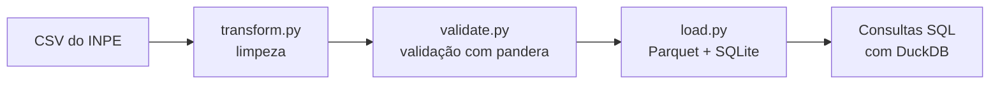

# Queimadas Tocantins
Pipeline de dados em Python que processa focos de calor detectados por satélite no estado do Tocantins, a partir do BDQueimadas, banco de dados público do INPE.

O projeto pega o CSV exportado do INPE, corrige os problemas do dado bruto, valida a qualidade e grava o resultado em formatos prontos para análise (Parquet e SQLite).

## Fluxo


## Problemas reais encontrados no dado bruto
| Problema | Como o pipeline trata |
|---|---|
| `-999` na coluna `RiscoFogo` (código do INPE para "sem dado"), que distorcia a média | Convertido em nulo |
| Caractere invisível (BOM, `\ufeff`) colado em uma data, que fazia a linha ser descartada na leitura | Removido antes da conversão de datas |
| Datas como texto | Convertidas para `datetime` |
| Nomes de colunas em formatos mistos | Padronizados em `snake_case` |

A validação (pandera) ainda garante que `risco_fogo` fique entre 0 e 1, que as coordenadas estejam dentro do Tocantins, que não existam valores negativos em precipitação e dias sem chuva, e que não apareçam colunas inesperadas. Se o INPE mudar o formato em algum mês, o pipeline avisa em vez de gravar dado ruim em silêncio.

## Resultado de exemplo
Período analisado: 16/09/2026 a 16/10/2026 (satélite NOAA-20), 19.025 focos.

| Município | Focos | FRP médio |
|---|---|---|
| Formoso do Araguaia | 2.229 | 13,2 |
| Pium | 1.194 | 14,6 |
| Mateiros | 868 | 16,1 |
| Arraias | 839 | 10,9 |
| Lagoa da Confusão | 814 | 14,4 |

Os 10 municípios com mais focos concentram cerca de 47% do total do período. Número de focos e intensidade do fogo (FRP, potência radiativa) não andam juntos: Mateiros tem menos focos que Pium, mas fogo mais intenso na média. É um recorte de um mês, então não permite conclusões sobre causas.

## Como rodar
Requer Python 3.12 ou superior.

```powershell
git clone https://github.com/felipedev-ti/queimadas-tocantins.git
cd queimadas-tocantins
py -m venv .venv
.\.venv\Scripts\Activate.ps1
pip install -r requirements.txt
```

1. No portal do INPE (BDQueimadas), exporte em CSV os focos do Tocantins para o período desejado.
2. Coloque o arquivo em `data/` e ajuste o caminho `ENTRADA` no `rodar.py`.
3. Execute:

```powershell
python rodar.py
```

Os arquivos gerados ficam em `data/processed/` (`focos.parquet` e `focos.db`).

## Testes
```powershell
python -m pytest
```

## Estrutura
```
queimadas/
├── transform.py   # limpeza e padronização
├── validate.py    # regras de qualidade (pandera)
└── load.py        # gravação em Parquet e SQLite
tests/             # testes com pytest
rodar.py           # executa o pipeline e faz uma consulta de exemplo
```

## Próximos passos
- [ ] Download automático dos dados do INPE (`extract.py`)
- [ ] Relatórios periódicos por município
- [ ] Processar vários meses sem duplicar registros
- [ ] Painel de visualização

## Fonte dos dados
[BDQueimadas, INPE](https://terrabrasilis.dpi.inpe.br/queimadas/bdqueimadas/): dados públicos de focos de calor detectados por satélite.